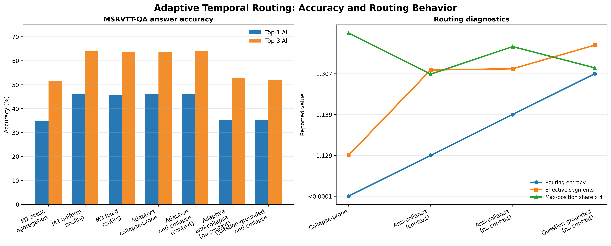

# Adaptive Temporal Routing for Video Question Answering

Academic companion repository for adaptive temporal routing, routing collapse, confidence-aware selection, and context dependence in MSRVTT-QA video question answering.

This release contains selected implementation components and diagnostics intended to document the method without exposing the complete training system, private data pipeline, or experiment infrastructure.

## Study Conditions

- **Adaptive, collapse-prone**: adaptive routing with auxiliary context and entropy-minimizing pressure.
- **Adaptive, anti-collapse**: adaptive routing with context, an entropy floor, position penalty, and diversity regularization.
- **Adaptive, anti-collapse without context**: the same anti-collapse routing policy with context disabled.
- **Question-grounded, anti-collapse without context**: anti-collapse routing over question-grounded segments, with context disabled.

## Public Scope

The Python files in this repository are compact, representative samples. They show the central routing equations, regularization terms, and evaluation diagnostics, but they are not the complete training implementation used for the experiments.

The repository intentionally excludes raw videos, annotations, extracted features, answer vocabularies, checkpoints, full routing records, private HPC paths, and the complete training script.

## Results Summary

| Condition | Context | Top-1 All | Top-1 In-Vocab | Top-3 All | Top-3 In-Vocab |
| --- | --- | ---: | ---: | ---: | ---: |
| M1 Static aggregation | No | 34.81% | 35.67% | 51.67% | 52.95% |
| M2 Uniform pooling | Yes | 46.04% | 47.18% | 63.84% | 65.43% |
| M3 Fixed routing, k=4 | Yes | 45.78% | 46.92% | 63.48% | 65.05% |
| Adaptive, collapse-prone | Yes | 45.86% | 47.00% | 63.53% | 65.11% |
| Adaptive, anti-collapse | Yes | 46.03% | 47.18% | 64.00% | 65.59% |
| Adaptive, anti-collapse | No | 35.26% | 36.14% | 52.58% | 53.89% |
| Question-grounded, anti-collapse | No | 35.32% | 36.20% | 51.91% | 53.20% |

Anti-collapse routing increases entropy, effective segment count, and temporal coverage while reducing fixed-position concentration. Context remains important for answer accuracy.



The overview figure combines the reported MSRVTT-QA accuracy conditions with aggregate routing diagnostics. The right panel rescales maximum-position share by four for visual comparison; the underlying values remain available in `results/metrics/adaptive_conditions.csv`.

### Model Result Figures

The public figure set includes selected validation accuracy and loss curves for each adaptive-routing condition:

- Collapse-prone routing: [accuracy](results/figures/collapse_prone_accuracy.png), [loss](results/figures/collapse_prone_loss.png)
- Anti-collapse routing with context: [accuracy](results/figures/anti_collapse_context_accuracy.png), [loss](results/figures/anti_collapse_context_loss.png)
- Anti-collapse routing without context: [accuracy](results/figures/anti_collapse_no_context_accuracy.png), [loss](results/figures/anti_collapse_no_context_loss.png)
- Question-grounded anti-collapse routing without context: [accuracy](results/figures/question_grounded_no_context_accuracy.png), [loss](results/figures/question_grounded_no_context_loss.png)

## Repository Layout

```text
Adaptive-Routing-VideoQA/
|-- README.md
|-- LICENSE
|-- requirements.txt
|-- configs/msrvtt_adaptive.yaml
|-- datasets/README.md
|-- models/
|   |-- README.md
|   |-- adaptive_router.py
|   |-- context_fusion.py
|   `-- grounded_router.py
|-- training/
|   |-- objectives.py
|   `-- evaluation.py
|-- diagnostics/
|   |-- README.md
|   `-- routing_metrics.py
|-- checkpoints/README.md
|-- docs/README.md
`-- results/
    |-- figures/
    `-- metrics/
```

## Data Availability

The datasets analysed during this study are publicly available from the following sources:

- MSRVTT-QA: https://huggingface.co/datasets/shiyili1111/MSR-VTT

The data preprocessing procedures, dataset preparation pipeline, train/validation/test splits, and additional resources required to reproduce the experiments are documented in the accompanying project materials.

## Requirements

PyTorch is intentionally not pinned because the HPC environment provides the CUDA/PyTorch installation.

```bash
pip install -r requirements.txt
```

## Reproducibility Note

This is a method and diagnostics companion. It is not intended to reproduce the complete training run without the protected data preparation, feature extraction, answer vocabulary, checkpoint, and experiment-management components.
