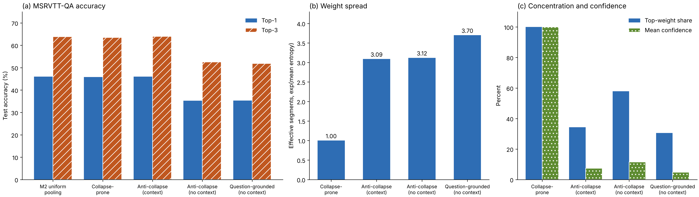

# Adaptive Temporal Routing for Video Question Answering

Companion repository for the paper *Does adaptive temporal routing select evidence? Collapse, confidence fallback, and context dependence in video question answering*.

This repository contains aggregate results, run configurations, and figures. The training and evaluation code, checkpoints, and per-question prediction and routing records are not public; they are available from the corresponding author on reasonable request.

## Study conditions

- **Adaptive, collapse-prone**: adaptive routing with context and entropy minimisation.
- **Adaptive, anti-collapse**: adaptive routing with context and an entropy floor.
- **Adaptive, anti-collapse without context**: the same configuration trained with an empty context string.
- **Question-grounded, anti-collapse without context**: the router scores segments taken after the question-to-video cross-attention block; trained with an empty context string.

The uniform-pooling reference **M2** comes from a companion manuscript by the same authors that is currently under consideration at another journal; it was not retrained for this work.

## Results on MSRVTT-QA (70,181 test questions)

| Model | Context | Top-1 all | Top-1 in-vocab | Top-3 all | Top-3 in-vocab |
| --- | --- | ---: | ---: | ---: | ---: |
| M2 uniform pooling (reference) | Yes | 46.04% | 47.18% | 63.84% | 65.43% |
| Adaptive, collapse-prone | Yes | 45.86% | 47.00% | 63.53% | 65.11% |
| Adaptive, anti-collapse | Yes | 46.03% | 47.18% | 64.00% | 65.59% |
| Adaptive, anti-collapse | No | 35.26% | 36.14% | 52.58% | 53.89% |
| Question-grounded, anti-collapse | No | 35.32% | 36.20% | 51.91% | 53.20% |

The test set is the preprocessed one described in `datasets/README.md`, so these accuracies are not directly comparable with results reported on the full MSRVTT-QA test set.



The figure is drawn by `results/plot_comparison.py` from `results/metrics/adaptive_conditions.csv`; column definitions are in `results/metrics/README.md`.

### Training curves

- Collapse-prone: [accuracy](results/figures/collapse_prone_accuracy.png), [loss](results/figures/collapse_prone_loss.png)
- Anti-collapse with context: [accuracy](results/figures/anti_collapse_context_accuracy.png), [loss](results/figures/anti_collapse_context_loss.png)
- Anti-collapse without context: [accuracy](results/figures/anti_collapse_no_context_accuracy.png), [loss](results/figures/anti_collapse_no_context_loss.png)
- Question-grounded without context: [accuracy](results/figures/question_grounded_no_context_accuracy.png), [loss](results/figures/question_grounded_no_context_loss.png)

## Repository layout

```text
Adaptive-Routing-VideoQA/
|-- README.md
|-- LICENSE
|-- requirements.txt
|-- configs/README.md
|-- datasets/README.md
|-- docs/README.md
|-- checkpoints/README.md
`-- results/
    |-- plot_comparison.py
    |-- figures/
    `-- metrics/
```

## Data availability

- MSR-VTT videos: https://huggingface.co/datasets/shiyili1111/MSR-VTT

## Regenerating the comparison figure

```bash
pip install -r requirements.txt
python results/plot_comparison.py
```

